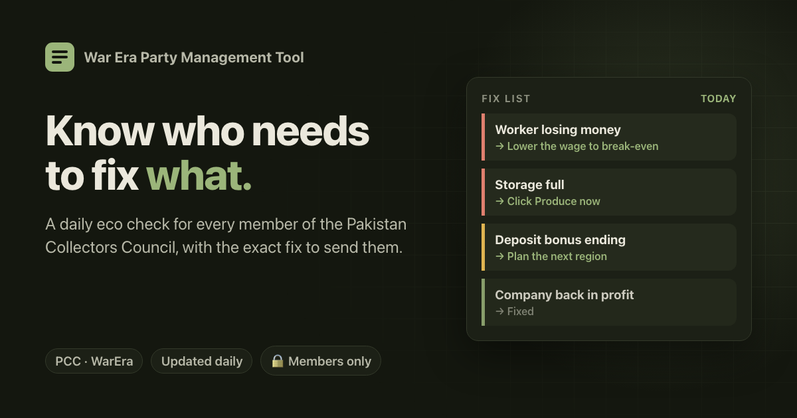
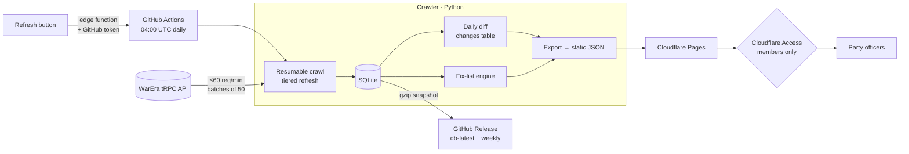

# WarEra Command Center

**A daily data pipeline and members-only dashboard for running an in-game political party in [WarEra](https://warera.io).** Every morning it crawls the game, finds which members have economic problems, works out the exact fix for each one, and tracks every problem until it's resolved.

> 🔒 **Source is private and the site is members-only.** This repo documents the system: architecture, pipeline design and engineering decisions. Happy to walk through the code in an interview.

---

## At a glance

| | |
|---|---|
| **Pipeline** | Scheduled ELT: crawl → SQLite → diff → static JSON export → deploy |
| **Volume per run** | ~1,400 companies, 400+ citizens, full profiles for every party and MU member |
| **Cost to run** | $0: GitHub Actions + Cloudflare Pages + Cloudflare Access free tiers |
| **Auth** | Cloudflare Zero Trust (email one-time PIN), with JWT verification in the edge functions |
| **Tests** | Python crawler suite + JS tests for auth and the refresh function, no network needed |

## The product: a fix list

The home page is a prioritised list of members' economic problems, with the exact fix to send each person:

| Problem | Level | Fix shown |
|---|---|---|
| Worker costs more than they produce | 🔴 urgent | Lower wage to break-even, or let them go |
| Company losing money at today's prices | 🔴 urgent | Cut wages, switch item, or move region |
| Storage full, production stopped | 🔴 urgent | Produce now |
| Storage ≥ 80% / deposit bonus ending < 24h | 🟡 watch | Plan ahead |

Each problem is tracked **from the day it first appears until it's fixed**. Profit is valued at order-book bid fill, with self-made inputs priced at market and shortfalls bought at the ask. Behind the fix list sit members, military units, government and a full per-player profile with daily history.

## Architecture

## Engineering decisions worth talking about

**Visitors never touch the upstream API.** One crawl a day reads the game. The site serves only pre-computed static JSON, so it's instant, costs nothing, and can't hammer the game's servers.

**A polite, resilient crawler.**
- Self-imposed limit of 60 req/min (the API allows 100), and it honours `ratelimit-*` headers
- tRPC batching: 50 calls count as one request (verified live), with HTTP 207 partial failures handled per call
- Exponential backoff on 429/5xx, plus an identifying User-Agent

**Resumable and incremental.** Every step is checkpointed in a `crawl_runs` table. A run cut off at the CI time limit is picked up by the next run. Tiered refresh: active players are refreshed daily, inactive players weekly, spread across the days of the week.

**Change data capture.** A `changes` table records daily diffs (level-ups, unit/party/country moves, joins and leaves), which power the history views.

**Privacy by design.** Account-private fields (email verification, preferences, location…) are dropped at ingest. They never reach the database or the site.

**Failure-safe deploys.** If a run fails, nothing is uploaded or deployed and the last good data stays live. The database is versioned as a release asset, with a dated weekly snapshot.

**Abuse-resistant manual refresh.** Members can trigger a full recrawl. It's audited (the run is named after whoever pressed it), refused while another run is in progress, and on a 30-minute cooldown.

**Validated against a second implementation.** The fix-list maths was checked against [WarEra Buddy](https://github.com/moezkayy/warera-buddy) on a real account: all 10 companies' profit/day matched within 0.03.

---

Built by <a href="https://github.com/moezkayy">@moezkayy</a>. Unofficial fan project. WarEra and its assets belong to their owners.
